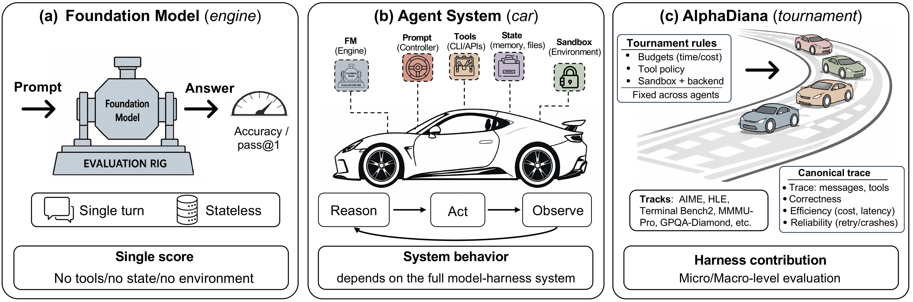

  # AlphaDiana

A modular evaluation framework for foundation models and agent systems on frontier reasoning benchmarks.

AlphaDiana provides a pluggable pipeline to evaluate LLM-based reasoning systems with support for multi-turn agentic workflows, sandboxed code execution, and symbolic math verification. This README walks through a reproducible end-to-end example using OpenClaw + AIME 2024.


## Data Flow

```
    YAML Config ──→ Runner ──→ Benchmark (load tasks)
                      │              │
                      │              ▼
                      │         Agent (generate answers)
                      │           │   ↕ Sandbox (code execution)
                      │           ▼
                      │         Scorer (verify answers)
                      │              │
                      ▼              ▼
                 results/<run_id>.jsonl ──→ Report / Dashboard
```

## Features

| Category | Options |
|---|---|
| **Agents** | [OpenClaw](https://github.com/anthropics/openclaw) (multi-turn ReAct with tool use), Direct LLM (single-turn baseline) |
| **Benchmark** | AIME 2024, AIME 2025, AIME 2026
| **Sandboxes** | ROCK (Docker-based), Local (subprocess), BoxLite (cloud) |
| **Scorers** | Exact Match, Numeric (configurable tolerance), Math Verify (SymPy symbolic equivalence), LLM Judge |

All components use a registry pattern and are extensible via plugins.

## Installation

### Prerequisites

- Linux
- Python >= 3.10
- conda
- Docker
- Git
- An OpenRouter (or other provider) API key

Verify prerequisites:

```bash
docker --version && git --version && conda --version
```

### Direct LLM

```yaml
run_id: "direct-llm"

agent:
  name: direct_llm
  version: "1.0"
  config:
    model: ""          
    api_base: ""
    api_key: "EMPTY"
    temperature: 0.6
    max_tokens: 

benchmark:
  name: aime
  config:
    dataset: "MathArena/aime_2026"
    split: "train"

scorer:
  name: numeric
  config:
    tolerance: 1e-6

max_concurrent: 
output_dir: "./results"
```
Run the following command:
```bash
# run
alphadiana run direct_llm.yaml
```

### Quick Start

```bash
git clone <repo-url> 
cd AlphaDiana
bash dev/quickstart.sh
```

The quickstart script will:
- Create a conda environment and install all dependencies
- Clone and set up `ref/ROCK` with an editable install
- Detect available ports (avoiding conflicts on shared servers)
- Start Redis, Ray, ROCK admin, and ROCK proxy services
- Run health checks and print next steps

For manual setup and troubleshooting, see [`docs/setup_detail.md`](docs/setup_detail.md).


### API Key Configuration

Create a `.env` file in the repository root:

```bash
cat > .env <<'EOF'
OPENROUTER_API_KEY="sk-or-v1-xxxxxxxx"
OPENAI_API_KEY="sk-xxxxxxxx"
EOF
```

To load into your current shell:

```bash
set -a && source .env && set +a
```

### Per-Terminal Environment Setup

Every new terminal session requires:

```bash
conda activate alphadiana
source dev/rock_env.sh
source dev/.rock_ports.env  
```

`dev/rock_env.sh` sets `PYTHONPATH`, `ROCK_CONFIG`, `ROCK_WORKER_ENV_TYPE`, proxy cleanup, and HuggingFace mirror configuration.

> **Convention**: All commands should be run from the repository root (`AlphaDiana/`) unless explicitly noted otherwise.


### 3. Deploy OpenClaw Agent
Before deployment, make sure the following fields in `rock_agent_config.yaml` are set correctly
- OPENAI_BASE_URL
- OPENAI_MODEL_NAME

#### When using vLLM

If you are using `vLLM`, `OPENAI_BASE_URL` must be set to the model service address that is accessible inside the Docker container.
```yaml
working_dir: "."

run_cmd: OPENCLAW_CONFIG_PATH=${working_dir}/openclaw.json nohup openclaw gateway >> /root/gateway.log 2>&1 &

runtime_env_config:
  type: node
  npm_registry: https://registry.npmmirror.com
  custom_install_cmd: npm install -g openclaw@2026.3.7
  install_timeout: 1200

env:
  OPENAI_BASE_URL: ""
  OPENAI_API_KEY: "EMPTY"
  OPENAI_MODEL_NAME: ""
  OPENCLAW_GATEWAY_TOKEN: "OPENCLAW"
```

```bash
# Deploy to ROCK sandbox
python openclaw_deploy/deploy.py \
  --agent-config dev/generated/rock_agent_config.openrouter_qwen_2_5_7b.resolved.yaml
# Note the SANDBOX_ID from output
```

> The generated config file contains your API key -- do not commit or share it.

Verify the gateway before running benchmarks:

```bash
curl -X POST \
  "$ROCK_PROXY_URL/sandboxes/<SANDBOX_ID>/proxy/v1/chat/completions" \
  -H "Authorization: bearer OPENCLAW" \
  -H "Content-Type: application/json" \
  -d '{"model":"openclaw","messages":[{"role":"user","content":"What is 2+3?"}],"temperature":0.0,"max_tokens":128}'
```

### 4. Run Evaluation
Before running the evaluation, make sure to fill in the `api_base` field in openclaw.yaml. The value of api_base should be the base URL printed in the output of the following deployment command.

```yaml
run_id: 
agent:
  name: openclaw
  version: 2026.3.7
  config:
    api_base: 
    model: openclaw
    gateway_token: OPENCLAW
    temperature: 
    max_tokens: 32768
    system_prompt: 

benchmark:
  name: aime
  config:
    dataset: MathArena/aime_2026
    split: train
sandbox: null
scorer:
  name: math_verify
  config:
    tolerance: 1e-6
num_samples: 32
max_concurrent: 16
output_dir: ./results
metadata:
  author: 
  gpu: 
  notes: 
```

```bash
# Validate & run
alphadiana validate openclaw.yaml
alphadiana run openclaw.yaml
```

Results are written to `results/<run_id>.jsonl`.

### 5. View Results

```bash
alphadiana report results/
```

## Configuration

Experiments are defined by a single YAML file. See [`configs/schema.yaml`](configs/schema.yaml) for the full schema.

```yaml
run_id: "openclaw-qwen3-8b-aime2024-001"   # auto-generated if omitted

agent:
  name: openclaw                  # openclaw | direct_llm
  version: "2026.3.7"
  config:
    api_base: "http://127.0.0.1:9001/apis/envs/sandbox/v1/sandboxes/<ID>/proxy/v1"
    model: openclaw
    gateway_token: "OPENCLAW"
    max_attempts: 3               # retry attempts (openclaw only)
    request_timeout: 600          # seconds (openclaw only)

benchmark:
  name: aime
  config:
    dataset: "HuggingFaceH4/aime_2024"
    split: "train"

sandbox: null                     # null | rock | local | boxlite

scorer:
  name: math_verify
  config:
    tolerance: 1e-6

max_concurrent: 1                 # parallel task count
num_samples: 32                   # samples per task (for pass@k)
output_dir: "./results"
metadata:                         # free-form tags (optional)
  author: "team-xyz"
```

Example configs: [`configs/examples/`](configs/examples/)

## CLI Reference

```bash
alphadiana run <config.yaml>                # Run evaluation
alphadiana validate <config.yaml>           # Validate config without running
alphadiana report <results_dir>             # Generate report from result files
alphadiana batch <c1.yaml> <c2.yaml> ...    # Run multiple configs (supports --parallel)
alphadiana list-benchmarks                  # List registered benchmarks
```

Override config values from CLI:

```bash
alphadiana run config.yaml \
  --override agent.config.temperature=0.5 \
  --override max_concurrent=4
```

Re-run failed tasks:

```bash
alphadiana run config.yaml --redo-all
```

## Dashboard

A web UI for managing and viewing evaluation tasks without manually editing YAML or reading JSONL files.

### Start the Dashboard

```bash
uvicorn alphadiana.dashboard.backend.main:app --host 0.0.0.0 --port 8000 --reload
```

Then open `http://<host>:8000` in your browser.

### Capabilities

- **Runs**: Browse all evaluation results -- accuracy, pass@k / avg@k (multi-sample), per-category scores, timing distribution
- **Compare**: Select multiple runs for side-by-side per-task comparison
- **Jobs**: Create, monitor, and manage evaluation tasks with real-time progress and logs
- **New Evaluation**: Configure and launch evaluations via a form (Direct LLM or OpenClaw)
- **Sandbox Management**: Deploy and manage OpenClaw sandboxes

### API Key Handling in Dashboard

The Dashboard API Key input supports two modes:

1. **Direct paste**: Paste the API key directly
2. **Environment variable reference**: Enter `$VAR_NAME` (e.g., `$OPENROUTER_API_KEY`) to read from `.env` or system environment

The Dashboard auto-matches API key variables based on the API base URL domain:

| API Base URL | Auto-matched Variable |
|---|---|
| `https://openrouter.ai/api/v1/` | `$OPENROUTER_API_KEY` |
| `https://api.openai.com/v1/` | `$OPENAI_API_KEY` |
| `https://api.siliconflow.cn/v1/` | `$SILICONFLOW_API_KEY` |
| `https://ark.cn-beijing.volces.com/api/...` | `$ARK_API_KEY` |
| `https://api.deepseek.com/v1/` | `$DEEPSEEK_API_KEY` |

## Port Cleanup

On shared servers, you may need to clean up previously allocated ports:

```bash
bash dev/cleanup_rock_ports.sh
```

This only terminates processes owned by the current user on ROCK-related ports.

## FAQs

For comprehensive troubleshooting (Docker permissions, Redis connection errors, Ray port conflicts, sandbox container issues, etc.), see the [Chinese README](README.md) or [`docs/setup_detail.md`](docs/setup_detail.md).

Common issues at a glance:

| Issue | Cause | Fix |
|---|---|---|
| `permission denied` on Docker socket | Current shell lacks `docker` group | Run `newgrp docker` or re-login |
| `deploy.py` sandbox timeout | Redis not running or `.venv` symlink broken | Check `docker ps` and `ls -la ref/ROCK/.venv` |
| Ray port `8265` already in use | Shared server port conflict | Use `find_rock_ports.py` to detect free ports |
| `rock.admin.main` Redis `ConnectionError` | Redis container not started | `docker start "$ROCK_REDIS_CONTAINER"` |
| Sandbox container exits immediately | `ref/ROCK/.venv` missing or invalid | `ln -sfn "$(python -c 'import sys; print(sys.prefix)')" ref/ROCK/.venv` |
