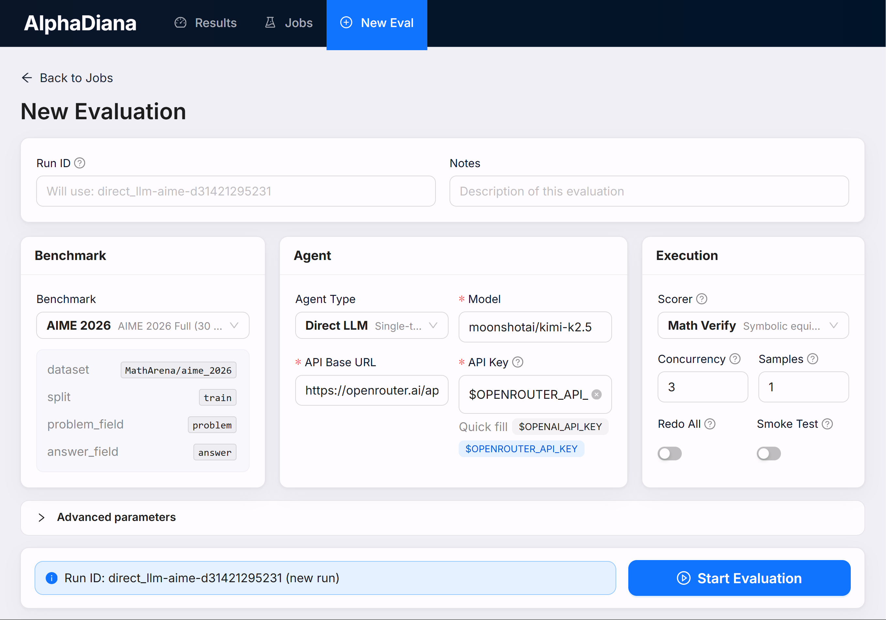
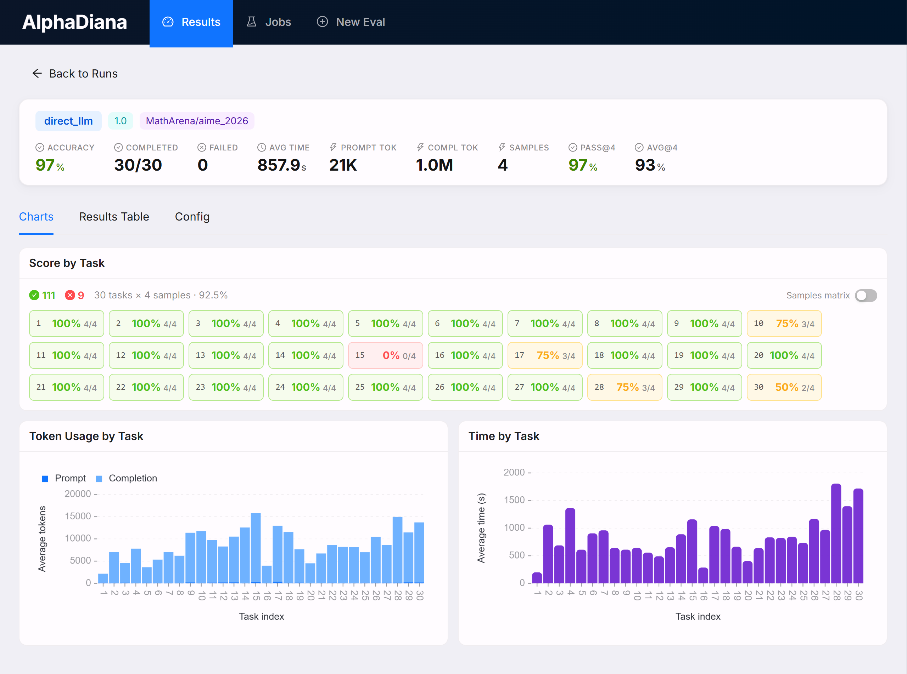

<h1 align="center">
  <br>
  <b>AlphaDiana: A Measurement System for Agents <br> in Verifiable Reasoning Tasks</b>
</h1>

<p align="center">
  <a href="https://alphadiana.org/"></a>
  <a href="https://arxiv.org/pdf/2610.20675"></a>
</p>

Compare scores and traces on verifiable reasoning tasks. Test tools, skills and memory. More experiments and analysis of agent behavior, components and resource use can be found in [**Paper**](https://arxiv.org/abs/2610.20675).

AlphaDiana runs agents on benchmarks, scores their answers and saves execution evidence for later analysis.

[**Positioning**](#positioning) | [**Motivation**](#why-alphadiana) | [**Scope**](#scope-at-a-glance) | [**Quick Start**](#quick-start) | [**Docs**](#documentation) | [**Citation and acknowledgement**](#citation-and-acknowledgement) | [**Related Project**](#related-project)

## Positioning

A **harness** controls how a model uses prompts, tools and persistent state.

Changing the harness can change model behavior. AlphaDiana links scores to execution evidence.


*A model, its harness and its execution settings jointly shape agent behavior.*

## Why AlphaDiana?

- **Compare agents:** compare scores and resource use across model–harness combinations on the same tasks.
- **Inspect failures:** trace wrong answers through execution status, tool interactions and saved action patterns.
- **Test components:** change tools, skills or memory and compare outcomes under recorded tasks and budgets.


*Execution produces traces and artifacts. The paper examples show benchmark scores, failure-label incidence, output-token use and tool-removal effects. Each plot identifies the model, benchmark and metric.*

## Scope at a glance

Follow setup, execution, measurement and extension in the table; links lead to configuration and runtime guides.

| Layer | Dimension | Options |
|---|---|---|
| **CONFIGURE** | Models | Qwen3.5-27B, Gemma-4-31B-IT, Kimi-K2.6<br>Configurable OpenAI-compatible endpoints |
| | [Harnesses](docs/harnesses/README.md) | OpenClaw, OpenCode, ZeroClaw, Pi, DeepSeek Harness<br>SWE-Agent (SWE-bench), Terminus2 (Harbor/TB2), DirectLLM baseline |
| | [Components](configs/micro_runs/README.md) | **Tools**: sets, filters, removal<br>**Skills**: math/general libraries<br>**Memory**: within-task, cross-sample, cross-task<br>**Prompts/context**: instructions, native compaction |
| | [Containers](docs/architecture/sandboxes.md) | **None, Docker, Podman**<br>Host/process, ROCK-managed or benchmark-specific environments |
| **RUN** | [Benchmarks](docs/benchmarks/README.md) | AIME 2026, GPQA-Diamond, HLE, IMO-AnswerBench<br>MMMU-Pro, SWE-bench Verified, Terminal-Bench 2, Custom |
| | [Controls](docs/configuration/README.md) | Task selection, Repeats, Sampling, Token/time/tool budgets<br>Concurrency, Retries, Resume, State isolation |
| | [Interfaces](docs/getting-started/python-api.md) | **CLI/YAML and Python API**: compute, analyze and export |
| **MEASURE** | [Measurements](docs/getting-started/python-api.md#built-in-measurements) | **Outcomes**: accuracy, Pass@k, Avg@k, status, failure labels |
| | | **Resources**: output tokens, wall time, cost per correct answer |
| | | **Process**: action composition/transitions, token/post-tool entropy |
| | | **Components**: score and behavior comparisons |
| | [Scoring](docs/architecture/registries.md#scorers) | Exact/numeric match, Math equivalence, Model judge<br>IMO, SWE-bench and Terminal-Bench verifiers |
| | [Evidence & exports](docs/getting-started/python-api.md) | JSONL, Traces, Tool calls, Usage, Available logprobs/artifacts<br>Markdown, Tables, PDF/SVG/PNG, Source hashes & coverage |
| **EXTEND** | [Plugins](docs/architecture/registries.md) | Harnesses, Benchmarks, Environments, Scorers, Metrics<br>[Saved-run analysis plugins](docs/getting-started/python-api.md#optional-model-judgments) |

<details>
<summary>Runtime combinations & measurement requirements</summary>

- Select supported combinations in the [API acceptance matrix](configs/acceptance/api/README.md) and harness guides.
- **None** means a direct API call or a supported host/process runtime.
- **Entropy** uses captured probabilities; post-tool curves require tool-feedback attribution.
- **Action/failure labels** use an explicitly enabled analysis model, which can differ from the execution model.
- Read **Pass@k / Avg@k** with the repeat count; match scorers, isolation and budgets when comparing runs.

</details>

## Quick Start

The examples use **Qwen3.5-27B** as the model and **OpenCode 1.3.2** as the harness. Both the [**CLI**](#cli) and [**Python API**](#python-api) run **3 AIME 2026 tasks**, with one sample per task, then analyze the saved results.

You need uv, Python ≥ 3.10, Podman, and an OpenAI-compatible model endpoint.

### 1. Install

Create an isolated Python environment and install the execution and analysis dependencies:

```bash
git clone --depth 1 https://github.com/tmlr-group/AlphaDiana.git
cd AlphaDiana
uv venv --python 3.10 .venv
source .venv/bin/activate
uv pip install -e '.[analysis,benchmarks,agents]'
```

### 2. Set up the model endpoint

Replace the URL and key with your provider's values. The model name must match an ID served by that endpoint.

```bash
export OPENAI_BASE_URL="https://your-provider.example/v1"
export OPENAI_API_KEY="your-api-key"
export OPENAI_MODEL_NAME="Qwen/Qwen3.5-27B"
```

### 3. Build the OpenCode controller image

Run from the repository root with Podman installed:

```bash
podman build \
  -f alphadiana/harness/opencode/deploy/Containerfile.podman-controller \
  -t localhost/alphadiana-opencode-podman:latest \
  alphadiana/harness/opencode/deploy
```

Both workflows use this image, which includes OpenCode **1.3.2** and task tools. [Podman&nbsp;setup&nbsp;guide](docs/benchmarks/podman.md)

### 4. Run and analyze with the CLI or Python API

Use `agent`, `data`, `scorer` and optional `env` with either interface. `compute` runs tasks; `analyzer` reads saved artifacts. Exports include tables, PDF/SVG/PNG figures, plotted data, source hashes and evidence coverage.

#### CLI

The CLI uses [`configs/examples/aime2026_opencode.yaml`](configs/examples/aime2026_opencode.yaml). It matches the Python example's `agent`, `data` and `scorer`, with the endpoint from step 2 and image from step 3.

Validate the config, compute the scored artifacts, then analyze and export them:

```bash
alphadiana validate configs/examples/aime2026_opencode.yaml
alphadiana compute configs/examples/aime2026_opencode.yaml
alphadiana analyzer results/aime_opencode_cli.jsonl --output-dir figures/aime_opencode_cli
```

The run saves scored attempts to `results/aime_opencode_cli.jsonl`.
The analyzer reads those artifacts and exports measurements to `figures/aime_opencode_cli/`.
Check the score, `score_status` and evidence coverage when reading the results.
[Troubleshooting →](docs/getting-started/troubleshooting.md)

#### Python API

Compose an agent, dataset and scorer, run the experiment, then analyze the saved results.


*Component composition and analysis workflow. Use the example below.*

Run `python` from the repository root in the same terminal, then execute:

```python
import alphadiana as ad

agent = ad.agent(
    "opencode",
    version="1.3.2",
    controller_mode="podman",
    controller_image="localhost/alphadiana-opencode-podman:latest",
)
data = ad.dataset("MathArena/aime_2026", benchmark="aime", max_tasks=3)
scorer = ad.scorer.create("numeric")
runner = ad.runner(
    run_id="aime_opencode_api",
    num_samples=1,
    task_retries=0,
    strict_report=True,
)

artifacts = runner.compute(agent=agent, data=data, scorer=scorer)

ad.analyzer(artifacts).export("figures/aime_opencode_api")
```

OpenCode manages its own Podman controller, configured through `ad.agent(...)`.

`compute()` saves scored attempts in `results/aime_opencode_api.jsonl` and returns artifact references. The export in `figures/aime_opencode_api/` contains the matching tables&nbsp;and&nbsp;figures.

<details>
<summary>Configuration and API details</summary>

Set run controls such as `run_id`, `num_samples` and `task_retries` at the YAML top level or on `ad.runner(...)`. Use `agent`, `data`, `scorer` and optional `env` for components. Legacy `run`, `benchmark` and `sandbox` remain supported. Give each section one name: `data` or `benchmark`; `env`&nbsp;or&nbsp;`sandbox`.

- Use `ad.scorer.create(...)`, an explicit harness `version=`, and `benchmark=` for hub datasets.
- For supported harnesses, pass a separate `ad.environment(...)` to `ad.runner(env=...)`.

[Full API guide: compose, reopen, rescore and extend →](docs/getting-started/python-api.md)

</details>

### More analysis options

Reopen either workflow's JSONL artifacts without rerunning the agent. Default analysis reads scores, usage counters and native traces. Entropy uses available probability evidence; coverage&nbsp;identifies&nbsp;missing&nbsp;measurements.

<details>
<summary>Reopen, compare and select export formats</summary>

Reopen either run and export SVG figures through the CLI or Python API:

```bash
alphadiana analyzer results/aime_opencode_cli.jsonl \
  --output-dir figures/aime_opencode_cli_reopened --formats svg
```

```python
import alphadiana as ad

ad.analyzer("results/aime_opencode_cli.jsonl").export(
    "figures/aime_opencode_cli_reopened", formats=("svg",),
)
```

Use a new export directory. Omit `--output-dir` to print JSON measurements, matching `ad.analyzer(...).compute()`. Compare runs using multiple CLI paths or a Python list.

</details>

<details>
<summary>Add action and failure labels with an analysis model</summary>

Configure an analysis model that can return structured JSON annotations:

```bash
export ANALYSIS_BASE_URL="https://your-provider.example/v1"
export ANALYSIS_API_KEY="your-api-key"
export ANALYSIS_MODEL="your-analysis-model-id"
```

Annotate either saved run with `--judge` in CLI or `judge=True` in Python:

```bash
alphadiana analyzer results/aime_opencode_cli.jsonl \
  --judge --output-dir figures/aime_opencode_cli_annotated
```

```python
import alphadiana as ad

ad.analyzer(
    "results/aime_opencode_cli.jsonl", judge=True,
).export("figures/aime_opencode_cli_annotated")
```

Use a new export directory. See [annotation requirements and caching](docs/getting-started/python-api.md#built-in-measurements).

</details>

## Documentation

AlphaDiana connects experiment setup, execution and analysis through four stages:

1. **Configure:** select tasks, a model and harness, execution environments, a scorer and budgets.
2. **Execute & score:** the runner manages sessions; the harness runs the agent; the scorer evaluates answers.
3. **Save evidence:** retain scores, execution status, outputs, traces and resource measurements in result records.
4. **Analyze & export:** reopen those records to compare runs, inspect behavior and produce tables and figures.

**AlphaDiana system architecture**


*The runner manages sessions and harnesses; saved evidence connects execution, scoring and analysis.*

[Architecture →](docs/architecture/README.md)

<!-- Temporarily hidden until the dashboard includes analyze content and interactions.
## Dashboard

The dashboard lets you launch evaluations, monitor job logs, inspect trajectories, and compare saved runs. From the repository root, with your Python environment active:

```bash
pip install -e '.[dashboard]'
cd alphadiana/dashboard/frontend
npm install
cd ../../..
cd alphadiana/dashboard
./run.sh
```

Open the frontend URL printed by the launcher. See [Dashboard](docs/dashboard.md) for production mode, data directories, and supported ROCK sandbox controls.

<p align="center">
  
  
</p>

*Configure a run in New Evaluation (left) and inspect saved runs in the Results view (right). The dashboard connects run setup, monitoring, and result inspection.*
-->

| I want to… | Start here |
|---|---|
| **Run** an experiment | [Getting Started](docs/getting-started/README.md), [Configuration](docs/configuration/README.md), [Presets](configs/README.md) |
| **Choose** a harness or benchmark | [Harnesses](docs/harnesses/README.md), [Benchmarks](docs/benchmarks/README.md) |
| **Analyze** saved runs | [Python API](docs/getting-started/python-api.md), [Analysis modules](alphadiana/analysis/README.md) |
| **Extend** the system | [Architecture](docs/architecture/README.md), [Analysis modules](alphadiana/analysis/README.md), [Scripts](scripts/README.md) |

<details>
<summary>CLI reference</summary>

| Command | Description |
|---|---|
| `alphadiana env` | Check configured service health |
| `alphadiana compute <config.yaml>` | Compute scored artifacts (`run` remains an alias) |
| `alphadiana analyzer <results.jsonl>...` | Compute measurements as JSON; add `--output-dir` to export figures |
| `alphadiana validate <config.yaml>` | Validate a config locally |
| `alphadiana report <results_dir>` | Print Markdown reports from saved result JSONL files |
| `alphadiana batch <config1> <config2> ...` | Run multiple experiments |
| `alphadiana list-benchmarks` | List the benchmark registry used by the Runner |

Use `-o key=value` to override configuration values, for example `-o max_concurrent=4`.

</details>

<details>
<summary>Repository map</summary>

```text
alphadiana/
  cli/           # command-line entry points
  engine/        # execution, configuration, and rollout campaigns
  harness/       # agent implementations and runtime skills
  benchmarks/    # task loaders and official verifier integrations
  scorer/        # answer evaluation and scorer interfaces
  results/       # persistence, traces, score status, and sample statistics
  analysis/      # measurement plugins, Analyzer composition, and exports
  dashboard/     # React frontend and FastAPI backend
scripts/
  setup/         # environment and dependency setup
  validation/    # preflight, smoke tests, and evaluator audits
tests/           # grouped by analysis, API, engine, harness, and benchmark
configs/         # experiment configurations
docs/            # guides, contracts, and documentation assets
```

</details>

## Citation and acknowledgement
If you find the project helpful, please cite:

```bibtex
@article{zhou2026alphadiana,
  title = {{AlphaDiana}: A Measurement System for Agents in Verifiable Reasoning Tasks},
  author={Zhanke Zhou and Zongze Li and Weikai Huang and Xuan Li and Chentao Cao and Xiao Feng and Xiangyu Lu and Jinbo Hu and Menghan Lu and Yi Xie and Nico Pelleriti and Shiyang Liu and Max Zimmer and Brando Miranda and Jiangchao Yao and Bo Liu and Sanmi Koyejo and Sebastian Pokutta and Bo Han},
  journal = {arXiv preprint arXiv:2610.20675},
  year = {2026}
}
```

We thank contributors, collaborators and open-source communities behind [OpenClaw](https://github.com/openclaw/openclaw), [ROCK](https://github.com/alibaba/ROCK) and other tools.

## Related Project

Please also check out [AlphaApollo](https://alphaapollo.org/), our system for deep agentic reasoning ([arXiv](https://arxiv.org/abs/2510.06261), [GitHub](https://github.com/tmlr-group/AlphaApollo)).
