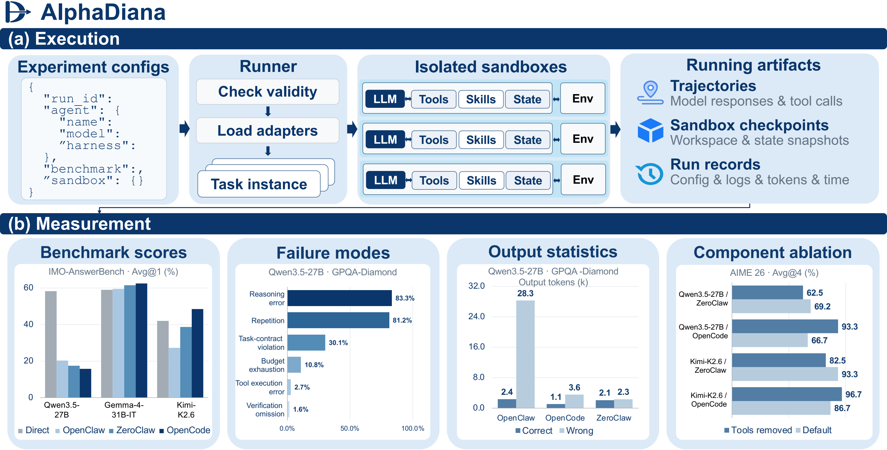
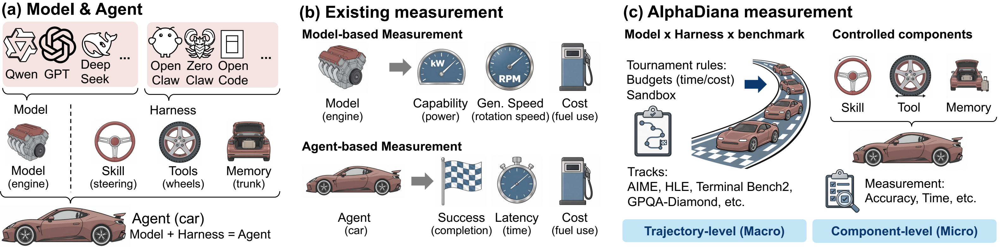
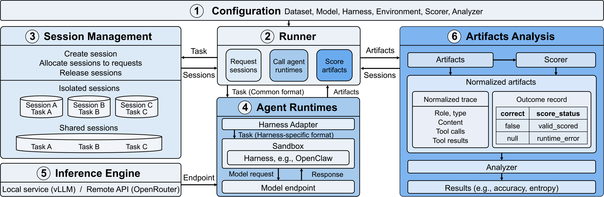
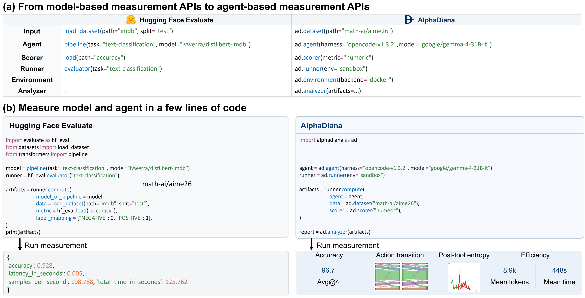

# AlphaDiana: A Measurement System for Agents in Verifiable Reasoning Tasks

**AlphaDiana** is an open-source measurement system for **LLM-based agents on verifiable reasoning tasks**. It runs configured agents against benchmarks, scores their outputs, and saves execution evidence. Researchers can compare correctness, execution failures, action patterns, and resource use across recorded conditions.

## Why AlphaDiana?

AlphaDiana connects final scores with saved trajectories, failures, and resource measurements.



*What can you measure? The lower panels show benchmark scores across model–harness combinations, failure-label incidence, output-token usage for correct and wrong trajectories, and score changes when tools are removed. The upper panel shows how execution produces the evidence for these measurements. Values come from the paper experiments.*

These measurements support three research tasks:

- **Compare complete agents.** Evaluate native harnesses against a direct LLM baseline under recorded task, model, environment, and budget settings.
- **Inspect execution.** Connect correct and incorrect answers to execution status, available traces, token usage, and elapsed time.
- **Compare component settings.** Examine how changes to tools, skills, and memory affect outcomes and execution patterns.

### Scope at a glance

| Dimension | Integrated options and capabilities |
|---|---|
| **Models** | **Qwen3.5-27B, Gemma-4-31B-IT, Kimi-K2.6** in the paper experiments; configurable model IDs and OpenAI-compatible endpoints. Execution and analysis can use separate models. |
| **Harnesses** | **OpenClaw, OpenCode, ZeroClaw, Pi, DeepSeek Harness**; **SWE-Agent** for SWE-bench; **Terminus2** through Harbor for Terminal-Bench 2; **DirectLLM** as the direct-model baseline. [Runtime guides](docs/harnesses/README.md). |
| **Harness components** | **Tools:** native tool sets, filtering and removal. **Skills:** math/general libraries and loading controls. **Memory:** within-task, cross-sample and cross-task persistence. **Prompts/context:** system instructions, workspace instructions and native compaction settings. [Component experiments](configs/micro_runs/README.md). |
| **Containers** | **None** (direct API or supported host/process execution), **Docker**, **Podman**. Environment integration includes local execution, ROCK-managed sandboxes and benchmark-specific task containers. [Environment guide](docs/architecture/sandboxes.md). |
| **Benchmarks** | **AIME 2026, GPQA-Diamond, HLE, IMO-AnswerBench, MMMU-Pro, SWE-bench Verified, Terminal-Bench 2**, plus custom tasks. Coverage spans mathematical/scientific reasoning, multimodal questions, repository repair and terminal tasks. [Benchmark guides](docs/benchmarks/README.md). |
| **Scoring** | Exact match, numeric matching, mathematical equivalence, model judging, IMO answer verification, official SWE-bench evaluation and Terminal-Bench verifier rewards. [Scorer registry](docs/architecture/registries.md#scorers). |
| **Experiment controls** | Model/harness/component comparisons; task selection; repeated samples; sampling, token, time and tool-call budgets; concurrency, retries, checkpoint resume and state-isolation settings. [Configuration](docs/configuration/README.md). |
| **Measurements** | **Outcomes:** accuracy, Pass@k, Avg@k, execution/scoring status and failure-label incidence. **Resources:** output tokens, wall time and cost per correct answer. **Process:** action composition/transitions and token/post-tool entropy. **Components:** score and behavior comparisons across tool, skill and memory settings. [Analysis guide](docs/getting-started/python-api.md#built-in-measurements). |
| **Evidence and exports** | Result JSONL, native trajectories, tool interactions, usage counters, available logprobs and retained artifacts; Markdown reports, analysis tables and PDF/SVG/PNG figures with source hashes and coverage records. [Saved-run analysis](docs/getting-started/python-api.md). |
| **Interfaces** | **CLI + YAML** for validation, single runs and batches; **Python API** for composing experiments, reopening saved runs, rescoring and offline analysis. [Python API](docs/getting-started/python-api.md). |
| **Training-data capture (Pi)** | Native-token **SFT/GRPO** rollout capture with token IDs, behavior logprobs, masks and task rewards. [Capture contract](docs/harnesses/pi-training.md). |
| **Extensions** | Register custom harnesses, benchmarks, environments, scorers and observational metrics; add analysis plugins for saved-run measurements. [Registries](docs/architecture/registries.md) · [Analysis plugins](docs/getting-started/python-api.md#optional-model-judgments). |

Choose runtime combinations through the harness guides and [API acceptance matrix](configs/acceptance/api/README.md). Entropy measurements use captured probability evidence; action and failure annotations use an explicitly enabled analysis model.



*A model, its harness, and its execution settings jointly shape an agent's behavior. AlphaDiana measures the resulting agent through task outcomes and execution evidence.*

## How it works

The evaluation and analysis stages follow one evidence path:

1. **Configure.** Select tasks, agents (model and harness), environments, scorers, and execution budgets.
2. **Execute and score.** The runner coordinates sessions and native harness execution. Scorers evaluate task outputs.
3. **Save evidence.** Result records link scores and execution status to retained outputs, available traces, and resource measurements.
4. **Analyze and export.** Read saved evidence to compare runs, inspect execution, and produce tables and figures.



*The runner coordinates configured sessions while native harnesses retain their control loops. Model endpoints supply inference; execution environments run tools. Saved artifacts connect execution to scoring and analysis. File reuse and memory retention are recorded separately.*

See [Architecture](docs/architecture/README.md) for the component interfaces and session lifecycle.

## Quick Start

This example runs one AIME 2026 task with one sample, then reads the saved result.

### 1. Install

Python 3.10 or newer is required. Native harnesses have additional runtime prerequisites, described in [Native harnesses](#native-harnesses).

```bash
git clone https://github.com/tmlr-group/AlphaDiana.git
cd AlphaDiana
python -m venv .venv
source .venv/bin/activate
pip install -e '.[analysis,benchmarks,agents]'
```

### 2. Configure the model endpoint

The following commands use the **Qwen3.5-27B experiment preset**. Set the model name to the ID served by your Qwen endpoint:

```bash
export OPENAI_BASE_URL="https://your-provider.example/v1"
export OPENAI_API_KEY="your-api-key"
export OPENAI_MODEL_NAME="Qwen/Qwen3.5-27B"
```

The endpoint must support this preset's streaming, logprobs, and `extra_body.chat_template_kwargs.enable_thinking` fields. The preset sets `temperature=0.0`, `top_p=0.95`, and a 32768-token output budget. For another model or endpoint, select or adapt a configuration through the [Configuration guide](docs/configuration/README.md).

### 3. Validate and run

```bash
alphadiana validate configs/macro_runs/aime2026_directllm_qwen35_27b.yaml \
  -o benchmark.config.max_tasks=1
alphadiana run configs/macro_runs/aime2026_directllm_qwen35_27b.yaml \
  -o run_id=quickstart_aime_directllm_t1_k1 \
  -o benchmark.config.max_tasks=1 \
  -o num_samples=1
```

`validate` checks the configuration locally. `run` downloads or loads the benchmark tasks and calls the configured model endpoint.

### 4. Inspect the saved result

The run writes `results/quickstart_aime_directllm_t1_k1.jsonl` and linked execution artifacts. Print a Markdown report from the saved results:

```bash
alphadiana report results/
```

To save the report, use `alphadiana report results/ > report.md`. Start with each record's `score_status`, score, and execution status. See [Getting Started](docs/getting-started/quick-start.md) for the full walkthrough and [Troubleshooting](docs/getting-started/troubleshooting.md) for setup failures.

## Python API

The Python API composes the same Runner and component registries as the CLI. This example runs OpenCode on three AIME 2026 problems, scores its answers, and exports analysis from the saved evidence. It uses the provider environment variables from Quick Start and the agent's default execution settings.

### Build the OpenCode controller image

With a working Podman installation, run this command from the repository root:

```bash
podman build \
  -f alphadiana/harness/opencode/deploy/Containerfile.podman-controller \
  -t localhost/alphadiana-opencode-podman:latest \
  alphadiana/harness/opencode/deploy
```

This builds a local container image from [`Containerfile.podman-controller`](alphadiana/harness/opencode/deploy/Containerfile.podman-controller). The recipe starts from Ubuntu 22.04 and installs Node.js 22, OpenCode **1.3.2**, and task tools. The final directory supplies the build context; `-t` assigns the image name `localhost/alphadiana-opencode-podman:latest`.

Use that same image name in `controller_image` below. OpenCode runs inside this controller and calls the configured model endpoint for inference. See the [Podman setup guide](docs/benchmarks/podman.md) for runtime checks.

### Run and analyze

```python
import alphadiana as ad

# Select the agent harness and the problems to evaluate.
agent = ad.agent(
    "opencode", version="1.3.2", controller_mode="podman",
    controller_image="localhost/alphadiana-opencode-podman:latest",
)
data = ad.dataset("MathArena/aime_2026", benchmark="aime", max_tasks=3)
scorer = ad.scorer.create("numeric")

# Run the agent and save its answers, scores, and execution traces.
artifacts = ad.runner(run_id="aime_opencode_demo").compute(
    agent=agent, data=data, scorer=scorer,
)

# Analyze the saved run and export tables and figures.
ad.analyzer(artifacts).export("figures/aime_opencode_demo")
```

Results and execution evidence are saved under `results/`. The final line performs offline analysis and exports tables and PDF/SVG/PNG figures.



*Functional interface from the AlphaDiana manuscript (Figure 4), rendered from `AlphaDiana-interface.pdf`. It connects execution components to analysis outputs; see [figure sources](docs/assets/README.md) for the source file and hashes.*

The executable example above uses the current API: `ad.scorer.create(...)`, explicit harness `version=` values, and `benchmark=` for dataset hub paths. OpenCode manages its own Podman controller through `controller_mode` and `controller_image`. For harnesses that accept a separate environment, create a specification with `ad.environment(...)` and pass it to `ad.runner(env=...)`. See [Python API and analysis](docs/getting-started/python-api.md) for supported backends, saved-run analysis, rescoring, and component extensions.

## Native harnesses

Choose a harness and follow its runtime guide before running the corresponding experiment configuration. Native harnesses own their reasoning and tool-use loops; AlphaDiana coordinates tasks, captures available evidence, and applies the configured scorer.

| Harness | Setup and execution entry point |
|---|---|
| **OpenClaw** | [Gateway and runtime guide](docs/harnesses/openclaw.md) |
| **OpenCode** | [Native runtime guide](docs/harnesses/opencode.md) |
| **ZeroClaw** | [Native runtime guide](docs/harnesses/zeroclaw.md) |
| **SWE-Agent** | [SWE-bench Verified Mini runbook](docs/benchmarks/swebench-verified-mini.md) |
| **Terminus2** | [Terminal-Bench 2 and Harbor runbook](docs/benchmarks/terminal-bench-2.md) |

See the [Harnesses index](docs/harnesses/README.md) for adapters and the [Benchmarks index](docs/benchmarks/README.md) for task-specific setup. The [API acceptance matrix](configs/acceptance/api/README.md) documents explicit benchmark/harness combinations, runtime identities, and verification requirements.

## Analysis and outputs

Evaluation and analysis produce three kinds of output:

| Output | What it contains |
|---|---|
| Result JSONL and linked artifacts | Task outputs, scores, execution status, runtime settings, available traces, and usage counters |
| Markdown report | A summary of saved evaluation outcomes from `alphadiana report` |
| Analysis export | Measurement tables, PDF/SVG/PNG figures, plotted data, source hashes, and coverage information |

**Scoring** determines whether an answer satisfies the configured task evaluator. **Offline analysis** reads saved results to compute performance, reliability, resource use, and entropy where probability evidence is available. Reopen the Quick Start result in a separate Python session:

```python
import alphadiana as ad

ad.analyzer("results/quickstart_aime_directllm_t1_k1.jsonl").export(
    "figures/quickstart_aime"
)
```

**Model annotations** label actions and failures from saved trajectories. Configure the analysis model, then enable these additional model calls with `judge=True`:

```bash
export ANALYSIS_BASE_URL="https://your-provider.example/v1"
export ANALYSIS_API_KEY="your-api-key"
export ANALYSIS_MODEL="your-analysis-model-id"
```

```python
ad.analyzer(
    "results/quickstart_aime_directllm_t1_k1.jsonl", judge=True
).export("figures/quickstart_aime_annotated")
```

Coverage records identify the evidence available for each measurement. Post-tool entropy uses requests following tool feedback; native tool-use runs provide those trajectories. The [Python API and analysis guide](docs/getting-started/python-api.md) describes measurement requirements, judge configuration, and cache provenance.

For comparisons, inspect the scorer identity, expected sample count, recorded `isolation_mode`, and execution budget. Read Pass@k and Avg@k with the configured `num_samples`. The [Results](docs/results.md) page presents selected paper tables and process-analysis figures.

<!-- Temporarily hidden until the dashboard includes analyze content and interactions.
## Dashboard

The dashboard lets you launch evaluations, monitor job logs, inspect trajectories, and compare saved runs. From the repository root, with your Python environment active:

```bash
pip install -e '.[dashboard]'
cd alphadiana/dashboard/frontend
npm install
cd ../../..
cd alphadiana/dashboard
./run.sh
```

Open the frontend URL printed by the launcher. See [Dashboard](docs/dashboard.md) for production mode, data directories, and supported ROCK sandbox controls.

<p align="center">
  
  
</p>

*Configure a run in New Evaluation (left) and inspect saved runs in the Results view (right). The dashboard connects run setup, monitoring, and result inspection.*
-->

## Documentation

| Your next task | Entry point |
|---|---|
| Find the main concepts and guides | [Welcome](docs/README.md) |
| Install, run, or troubleshoot | [Getting Started](docs/getting-started/README.md) |
| Select a native harness | [Harnesses](docs/harnesses/README.md) |
| Set up a benchmark and its verifier | [Benchmarks](docs/benchmarks/README.md) |
| Configure an experiment | [Configuration](docs/configuration/README.md) and [experiment presets](configs/README.md) |
| Compose, reopen, rescore, or analyze through Python | [Python API and analysis](docs/getting-started/python-api.md) |
| Inspect the implementation | [Architecture](docs/architecture/README.md), [analysis modules](alphadiana/analysis/README.md), and [operator workflows](scripts/README.md) |

<details>
<summary>CLI reference</summary>

| Command | Description |
|---|---|
| `alphadiana env` | Check configured service health |
| `alphadiana run <config.yaml>` | Run an evaluation |
| `alphadiana validate <config.yaml>` | Validate a config locally |
| `alphadiana report <results_dir>` | Print Markdown reports from saved result JSONL files |
| `alphadiana batch <config1> <config2> ...` | Run multiple experiments |
| `alphadiana list-benchmarks` | List the benchmark registry used by the Runner |

Use `-o key=value` to override configuration values, for example `-o max_concurrent=4`.

</details>

<details>
<summary>Repository map</summary>

```text
alphadiana/
  cli/           # command-line entry points
  engine/        # execution, configuration, and rollout campaigns
  harness/       # agent implementations and runtime skills
  benchmarks/    # task loaders and official verifier integrations
  scorer/        # answer evaluation and scorer interfaces
  results/       # persistence, traces, score status, and sample statistics
  analysis/      # measurement plugins, Analyzer composition, and exports
  dashboard/     # React frontend and FastAPI backend
scripts/
  setup/         # environment and dependency setup
  validation/    # preflight, smoke tests, and evaluator audits
  action_audit/  # human action annotation and agreement
  paper_analysis/ # archived paper inputs and plotting workflows
tests/           # grouped by analysis, API, engine, harness, and benchmark
configs/         # experiment configurations
docs/            # guides, contracts, and documentation assets
```

</details>

## Acknowledgements

AlphaDiana is developed to support research on trustworthy agentic reasoning and reproducible evaluation of reasoning systems. We thank the contributors, collaborators, and open-source communities behind tools and systems that make this work possible, including [OpenClaw](https://github.com/openclaw/openclaw), [ROCK](https://github.com/alibaba/ROCK), and related infrastructure.

## Citation

If you use AlphaDiana in your research, please cite:

```bibtex
@article{zhou2026alphadiana,
  title = {{AlphaDiana}: A Measurement System for Agents in Verifiable Reasoning Tasks},
  author={Zhanke Zhou and Zongze Li and Weikai Huang and Xuan Li and Chentao Cao and Xiao Feng and Xiangyu Lu and Jinbo Hu and Menghan Lu and Yi Xie and Nico Pelleriti and Shiyang Liu and Max Zimmer and Brando Miranda and Jiangchao Yao and Bo Liu and Sanmi Koyejo and Sebastian Pokutta and Bo Han},
  journal = {arXiv preprint arXiv:2610.20675},
  year = {2026}
}
```
