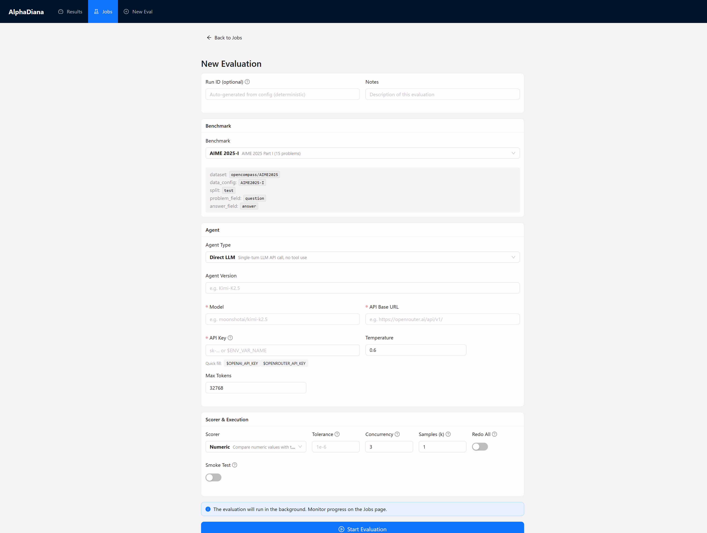

# AlphaDiana: A System for Evaluating Agentic Reasoning

**AlphaDiana** is a modular evaluation system for agentic reasoning with foundation models. It makes it easy to benchmark **reasoning agents** (e.g., OpenClaw) with **advanced models** (e.g., Qwen 3.5) on **frontier tasks** (e.g., AIME 2026) using pluggable benchmarks, sandbox backends, and scorers.

<p align="center">
  
</p>
<p align="center">
  <em><strong>Figure 1.</strong> Why agentic reasoning requires system-level evaluation: foundation models are evaluated like engines, agents behave like cars shaped by tools and state, and AlphaDiana serves as the tournament organizer that standardizes evaluation and records canonical traces.</em>
</p>

## Key Features

- 🤖 **OpenClaw Agent Support** — First-class integration with OpenClaw, enabling multi-turn agentic reasoning workflows out of the box
- 🧪 **Sandboxed Code Execution** — Run agent-generated code safely inside Docker-based ROCK sandboxes with full isolation
- 📊 **Multiple Benchmarks** — Built-in support for frontier reasoning benchmarks including AIME, MATH, and more
- 📋 **Web Dashboard** — Visual UI for managing evaluation tasks and viewing results
- 🔗 **Direct LLM Mode** — Evaluate any OpenAI-compatible model directly without agent orchestration

## Quick Start

### Install
A Linux environment, Python >= 3.10, conda, Docker, Git, and optionally an API key (required for remote providers like OpenRouter, but not for localhost deployments)

```bash
git clone https://github.com/tmlr-group/AlphaDiana
cd AlphaDiana
# Install dependencies & set up environment
bash scripts/quickstart.sh

# Pull the recommended reasoning image once
docker pull ghcr.io/tsrigo/openclaw-reasoning:20260320

# Export your model provider settings
export OPENAI_BASE_URL=...
export OPENAI_API_KEY=...
export OPENAI_MODEL_NAME=...
```
For a complete walkthrough, see [`docs/getting_started.md`](docs/getting_started.md). For manual setup and troubleshooting, see [`docs/setup_detail.md`](docs/setup_detail.md).

### Configure AlphaDiana
- dataset
- model: api, local run
- max_concurrent
- 

### Run OpenClaw Agent

Recommended minimal path: use the single-sandbox dynamic example first. It is the quickest way to verify that the full system can run end-to-end on a fresh machine.

For OpenRouter + AIME2025 reproducibility, prefer the config-driven one-click entry:

```bash
#1. Activate environment (required for every new terminal)
conda activate alphadiana && source scripts/rock_env.sh && source scripts/.rock_ports.env

#2. Copy and edit your config once
cp configs/examples/aime25_openrouter_oneclick.yaml /tmp/my_aime25.yaml
# Fill provider.openai_base_url / provider.openai_api_key(or openai_api_key_env)
# Fill provider.openai_model_name / benchmark.dataset / benchmark.split as needed

#3. Run with one command
bash scripts/run_aime25_openrouter.bash --config /tmp/my_aime25.yaml
```

If the run fails, the script prints targeted warnings (auth, startup timeout, upstream/session connectivity, Ray/Redis hints) with follow-up guidance in [docs/openclaw_aime25_fix_changelog_repro_20260322.md](docs/openclaw_aime25_fix_changelog_repro_20260322.md).

Manual baseline path (single-sandbox dynamic example):

```bash
# Activate environment (required for every new terminal)
conda activate alphadiana && source scripts/rock_env.sh && source scripts/.rock_ports.env

# Run example, TODO: what is dynamic???
alphadiana validate configs/examples/openclaw_aime2024_dynamic.yaml
alphadiana run configs/examples/openclaw_aime2024_dynamic.yaml

# View results
alphadiana report results/
```

This example now defaults to a single sandbox, `4g` memory, `1` CPU, and `max_concurrent: 1`. For higher concurrency, just change `max_concurrent` in the YAML — the CLI will create the matching number of sandboxes automatically.


### Run a Custom Problem Set

The `custom` benchmark lets you define problems directly in YAML — no dataset download required. Useful for spot-checking a specific problem or quick debugging.

```yaml
benchmark:
  name: custom
  config:
    problems:
      - id: "my_problem"
        problem: "Find the number of ordered pairs (x,y) ..."
        answer: "117"
```

```bash
alphadiana run configs/examples/openclaw_custom.yaml
```

Any agent and scorer work with `custom` the same way as any other benchmark.

### Run Direct Reasoning with Foundation Models

Directly evaluate any model without agent - useful for quick baseline
  benchmarking
```bash
# run
alphadiana run configs/examples/direct_llm.yaml
```


## Data Flow


```
YAML Config ----> Runner -----------> Benchmark (load tasks)
                     |                 |
                     |                 v
                     |                 Agent (generate answers)
                     |                 |   <-> Sandbox (code execution)
                     |                 v
                     |               Scorer (verify answers)
                     |                 |
                     v                 v
                   results/<run_id>.jsonl ----> Report / Dashboard
```


## Dashboard

A web UI for managing and viewing evaluation tasks without manually editing YAML or reading JSONL files. For full usage details (installation, page features, API key configuration, environment variables), see [`docs/dashboard.md`](docs/dashboard.md).



### Install & Build

```bash
pip install -e '.[dashboard]'        # Install backend dependencies (fastapi, uvicorn, httpx)
cd alphadiana/dashboard/frontend
npm install && npm run build          # Build the frontend
cd ../../..
```

### Start the Dashboard

```bash
source scripts/rock_env.sh               # Load ROCK environment (required for sandbox features)
source scripts/.rock_ports.env            # Load dynamic ports

cd alphadiana/dashboard
./run.sh                              # Development mode (frontend hot reload at http://localhost:5173)
./run.sh --prod                       # Production mode (single port at http://localhost:8000)
```

If the default port is occupied, `run.sh` will automatically detect and switch to the next available port.

